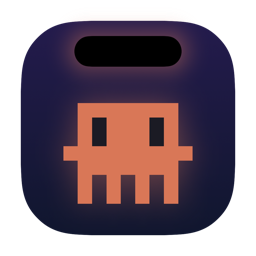
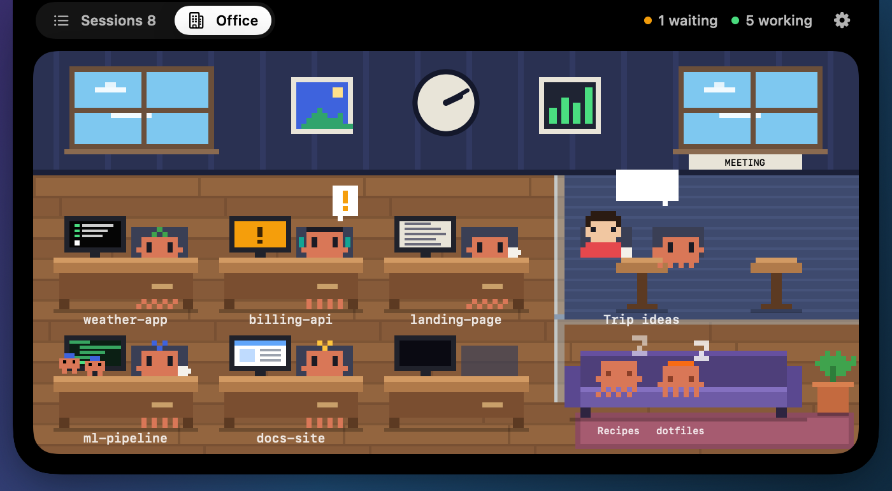
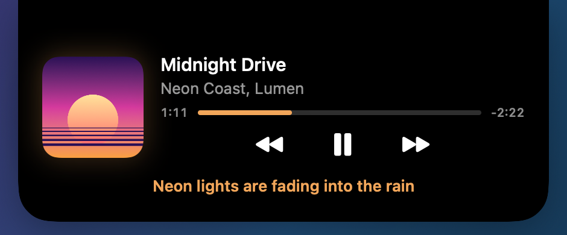
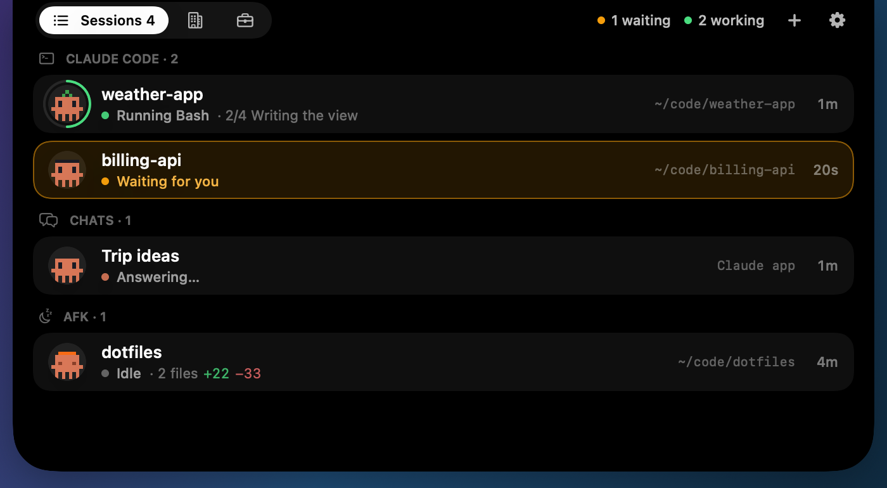
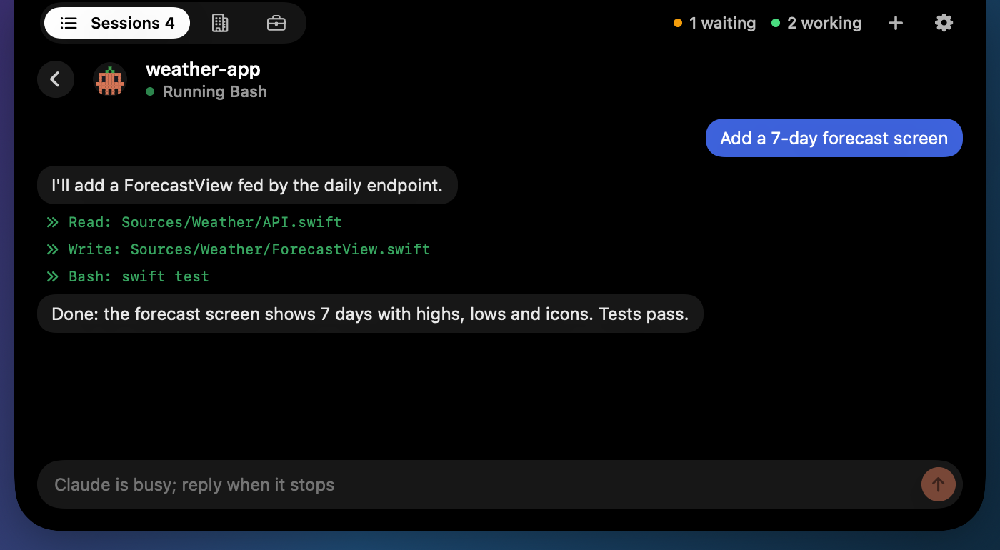
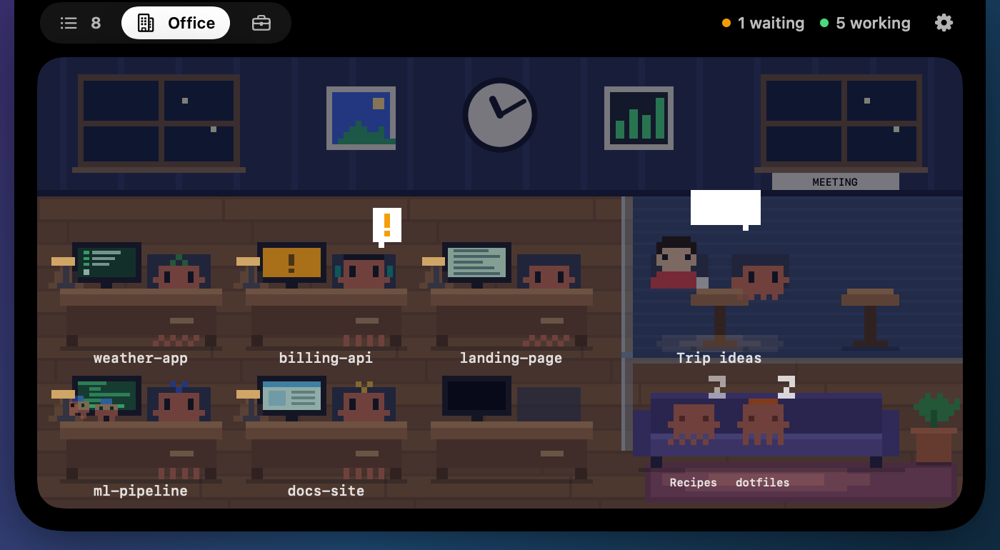
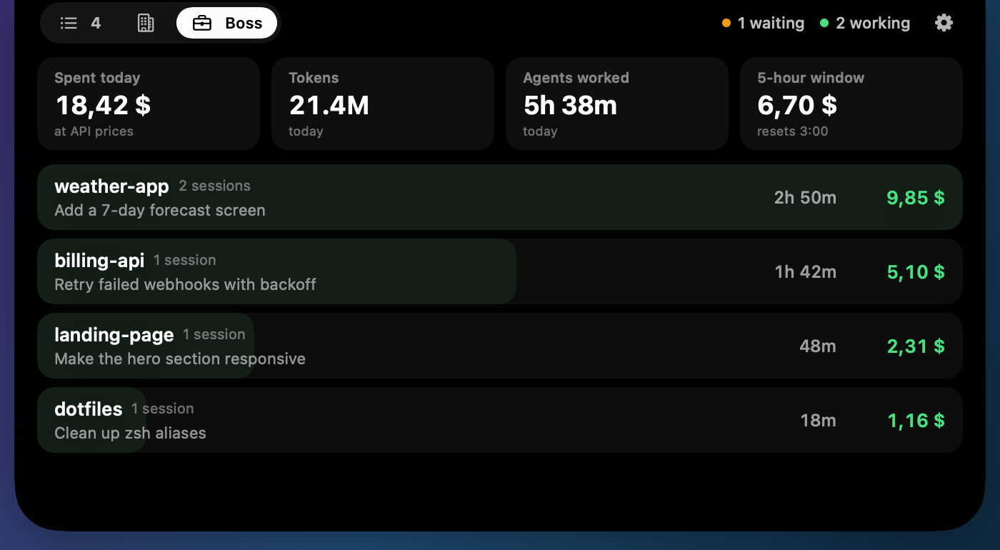
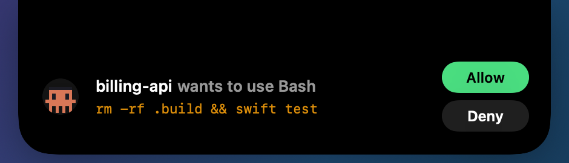
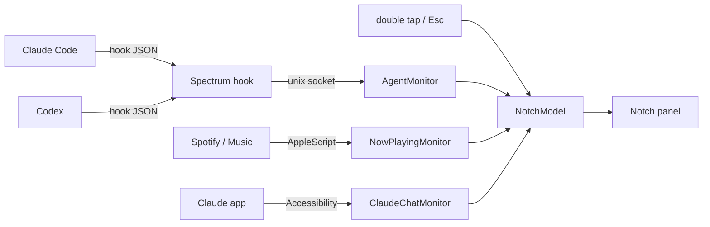

<div align="center">



# Spectrum

**Dynamic Island for the Mac notch: now-playing music and a live pixel office of your Claude and Codex agents.**

[](https://github.com/asykixd/spectrum/releases/latest)
[](https://github.com/asykixd/spectrum/actions/workflows/ci.yml)
[](LICENSE)
[](#installation)
[](Package.swift)



</div>

Spectrum is a native macOS app, written in Swift and SwiftUI, that turns the MacBook notch into
an iPhone-style Dynamic Island. When nothing is happening it is invisible. When music plays, the
notch grows a live activity. Double-tap <kbd>⌘</kbd> and it opens your agents: local Claude Code and Codex
sessions and Claude app chats, as a list or as a pixel-art office where Clawd mascots work at their
desks, talk in the meeting room and doze on the sofa.

## Features

### Music


- Invisible when idle; a compact live activity with artwork and a waveform tinted by the cover
  while music plays.
- Hover to expand: title, every featured artist, progress, previous / play-pause / next, and the
  line being sung when [lrclib.net](https://lrclib.net) has synced lyrics for the track.
- Two-finger swipe across the player changes the track.
- Spotify and Apple Music. Enable browser and QuickTime playback in Settings for Safari, Google
  Chrome and QuickTime Player. These extra sources support play/pause. Safari and Chrome need
  **Allow JavaScript from Apple Events**, and browser playback requires HTML media in the page.



### Agents

- Double-tap <kbd>⌘</kbd> (or <kbd>⌥</kbd> / <kbd>⌃</kbd>) for the agents panel; move the pointer
  away, press <kbd>Esc</kbd> or click outside to close it.
- **Sessions**: Claude Code, Codex, Cursor, GitHub Copilot, Claude app chats and AFK agents in separate groups, with what
  each one is doing right now. A ring around the avatar shows how much of its plan is done, and
  "2 files +22 −33" what it changed since your last prompt.
  Hover a row and press ✕ to hide it until it does something new.
- **Open in Terminal**: hover a Claude Code or Codex session started in macOS Terminal and click
  the terminal icon to focus its original tab. The same action is in the row's context menu.
- **New session**: the ＋ button in the panel picks one of your recent Claude Code folders (or any
  other) and an optional first prompt, and opens the session in Terminal.
- **Conversation**: click a Claude Code or Codex session to read its recent messages and tool
  calls. You can reply to an idle Claude Code session from the panel.
- **Office**: desks for working agents with screens showing their activity (a page while reading,
  a terminal, a browser, code) and subagents as small interns on the desk, a meeting room where
  you and Claude talk through a chat, a lounge for idle agents. Hover to highlight, click to open.
  The room follows your Mac's clock, from a blue sky to a lamp-lit night.
- **Boss**: today's agent work at a glance: what it would cost at API prices, tokens, how long
  agents worked, the current five-hour usage window, and per project the time, cost and the last
  thing you asked for. Read from Claude Code's transcripts, subagents included, only while the tab
  or sessions list is open. Configure daily and five-hour cost warnings in Settings. Session rows
  show today's estimated Claude Code API cost.

| Sessions | Conversation |
| --- | --- |
|  |  |





### Signals

The island calls you only when it matters, and quietly. When an agent needs permission or an
answer a small warning icon and a thin outline blink until you look; when a task finishes a small
checkmark shows for three seconds and goes away. While music plays, the icon sits on the artwork
instead of replacing it.


Hover the warning to see what the agent asks for and allow or deny it right there. If you don't
answer within a minute, Claude Code shows its usual dialog in the terminal.

Choose **Hide Agent Details** before sharing your screen. Spectrum suppresses agent alerts and
hands approvals back to the original agent. Open the panel and choose **Show Agent Details** to restore them.



## Installation

1. Download `Spectrum-<version>.dmg` from the
   [latest release](https://github.com/asykixd/spectrum/releases/latest) and open it.
2. Drag `Spectrum.app` onto **Applications**. (A `.zip` is attached too.)
3. The app is signed ad hoc, not notarized, so macOS blocks the first launch. Clear the
   quarantine flag once:

   ```sh
   xattr -dr com.apple.quarantine /Applications/Spectrum.app
   ```

4. Open Spectrum. It has no Dock icon; double-tap <kbd>⌘</kbd> to see it.
5. In the panel, click the gear and install hooks for your agent.
6. For Codex, review and trust Spectrum’s hooks in **Settings → Hooks** in the desktop app or with
   `/hooks` in the CLI. Start or reopen a local session to see it in Spectrum.

Requires macOS 14 or later, on Apple silicon or Intel.

<details>
<summary>Build from source</summary>

Requires Swift 6 (Xcode or Command Line Tools).

```sh
git clone https://github.com/asykixd/spectrum.git
cd spectrum
scripts/bundle.sh 1.0.0      # dist/Spectrum.app, Spectrum-1.0.0.zip and Spectrum-1.0.0.dmg
```

</details>

## Permissions

macOS asks once for each:

| Permission | Why |
| --- | --- |
| Accessibility | The double-tap shortcut and <kbd>Esc</kbd> system-wide; reading chat state from the Claude app |
| Automation → Spotify / Music | Reading the current track and sending play, pause, next, previous |
| Automation → Safari / Google Chrome / QuickTime Player | Reading playback and toggling play/pause when extra sources are enabled |
| Automation → Terminal | Starting Claude Code and focusing agent sessions in Terminal |

Spectrum is signed ad hoc, so macOS may ask again after an update.

## Settings

The gear in the agents panel opens Settings, installs or removes the hooks and quits Spectrum.

| Setting | Default |
| --- | --- |
| Launch at login | Off |
| Show music while it plays | On |
| Show playback from browsers and QuickTime | Off |
| Use real audio for the waveform (macOS 14.2+) | Off |
| Show synced lyrics in the expanded player | On |
| Blink when an agent needs permission or an answer | On |
| Remind me about waiting agents | 30 seconds |
| Flash a checkmark when a task finishes | On |
| Allow or deny permission requests from the island | On |
| Trackpad haptics when the island opens and closes | On |
| Agents panel shortcut | Double-tap ⌘ |
| Office characters | Clawd |
| Reply to idle Claude Code sessions from the panel | On |
| Show chats from the Claude app | On |
| Keep chats listed for | 15 minutes |
| Pause chat tracking on battery | On |
| Drop silent Claude Code sessions after | 1 hour |

## How it works



- **Claude Code** reports to Spectrum through hooks in `~/.claude/settings.json`. Each hook runs
  `Spectrum hook`, which forwards the event over a local socket, stays silent and always exits 0,
  so it never slows an agent down. Only a permission request waits, up to a minute, for an
  answer from the island, and prints the decision for Claude Code. Your own hooks are kept, and a backup of the file is saved the
  first time.
- **Codex** reports local CLI and desktop sessions through hooks in `~/.codex/hooks.json` (or
  `$CODEX_HOME/hooks.json`). Spectrum uses the same socket and permission flow and reads recent
  messages and tool calls from the session’s local transcript. See the
  [Codex hooks documentation](https://learn.chatgpt.com/docs/hooks) for trust review.
- **Cursor** and **GitHub Copilot** report local session activity through user hooks in
  `~/.cursor/hooks.json` and `~/.copilot/hooks/spectrum.json` (`$COPILOT_HOME` is supported).
  Continue in the agent's app for conversations and permission prompts.
- **Replies** run `claude -p --resume <session>` in the background: the answer appears in
  Spectrum, not in the session's open terminal.
- **Music**: MediaRemote no longer answers third-party apps since macOS 15.4, so Spectrum asks
  Spotify and Apple Music through AppleScript. Spotify reports only the first artist; the full
  list comes from the track's public embed page.
- **Claude app chats** have no hooks. Spectrum reads the app's accessibility tree: a Stop button
  means Claude is answering, the page title names the chat.

Source layout: `Sources/SpectrumCore` holds the UI-free, unit-tested logic; `Sources/Spectrum` is
the AppKit/SwiftUI app.

## Energy

Hidden, Spectrum stays under 1% CPU and about 40 MB of memory: nothing is polled while the
island is hidden, timers allow coalescing, and animations run only while visible.

Tracking Claude app chats costs the most, in Spectrum and in the Claude app, which keeps its
accessibility tree up to date while it is read. Reads drop to every 10 seconds while Claude is in
the background and pause on battery by default. Turn chats off in Settings to avoid the cost.

## Commands

The app binary doubles as a small CLI:

| Command | Description |
| --- | --- |
| `Spectrum install-hooks [claude\|codex\|cursor\|copilot]` | Add Spectrum's hooks for the selected agent (default: Claude Code) |
| `Spectrum uninstall-hooks [claude\|codex\|cursor\|copilot]` | Remove only Spectrum's hooks |
| `Spectrum hook` | Called by the hooks; forwards the event on stdin to the app |
| `Spectrum preview <dir>` | Render every state with demo data to PNG files (the screenshots above) |
| `Spectrum benchmark-usage [record count]` | Time cold, unchanged and append scans on synthetic transcripts |
| `Spectrum preview-snapshots Tests/PreviewSnapshots.json` | Check the rendered demo views against visual references. Add `--update` after reviewing an intentional change |

The binary lives at `/Applications/Spectrum.app/Contents/MacOS/Spectrum`.

## Development

```sh
swift format lint --strict --recursive Sources Tests Package.swift
swift build
swift test
.build/debug/Spectrum            # run without bundling
```

<details>
<summary>Testing with Command Line Tools only (no Xcode)</summary>

The Swift Testing macro plugin is not found by default:

```sh
swift test -Xswiftc -plugin-path -Xswiftc /Library/Developer/CommandLineTools/usr/lib/swift/host/plugins/testing
```

</details>

Releases are built by `.github/workflows/release.yml` when a `v*` tag is pushed. See
[CHANGELOG.md](CHANGELOG.md) and [ROADMAP.md](ROADMAP.md).

## License

[MIT](LICENSE)

---

<div align="center">
<sub>Built with <a href="https://claude.com/claude-code">Claude Code</a>. Clawd is Anthropic's Claude Code mascot; Spectrum is not affiliated with Anthropic.</sub>
</div>
