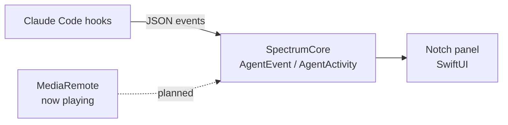

<div align="center">

# Spectrum

**Dynamic Island for the Mac notch: now-playing music and a live pixel office of your AI coding agents.**

[](https://github.com/asykixd/spectrum/actions/workflows/ci.yml)
[](LICENSE)
[](#installation)
[](Package.swift)

</div>

<!-- Demo: add a screenshot or GIF of the notch here once the UI lands, e.g. docs/demo.gif -->

Spectrum is a native macOS notch app written in Swift and SwiftUI. It turns the MacBook notch into
a Dynamic Island–style live activity for whatever music is playing, and into a tiny pixel-art
office where every Claude Code session sits at its own desk showing what it is doing right now.

> [!NOTE]
> Spectrum is in early development. The notch panel and the Claude Code event model work today;
> everything else below is tracked in [ROADMAP.md](ROADMAP.md).

## Features

| Feature | Status |
| --- | --- |
| Borderless panel sized to the hardware notch, content on the left and right "ears" | Done |
| Claude Code hook event decoding and per-session activity state (thinking, tool use, waiting, finished) | Done |
| Now playing: artwork, title, artist, play/pause/next for Music, Spotify and browsers | Planned |
| Compact live activity in the closed notch: artwork and audio waveform | Planned |
| Pixel office: one character per agent session, desk screen shows the current tool | Planned |
| Notch alert when an agent waits for your input, click to jump to its terminal | Planned |
| Codex, Cursor and GitHub Copilot agents | Planned |

## Installation

Requires macOS 14 or later and Swift 6 (Xcode or Command Line Tools). There are no prebuilt
releases yet; build from source:

```sh
git clone https://github.com/asykixd/spectrum.git
cd spectrum
swift build -c release
```

## Usage

```sh
swift run Spectrum
```

A black panel appears around the notch at the top of the main screen. Spectrum runs as an
accessory app, so it has no Dock icon or menu. To quit:

```sh
pkill -f Spectrum
```

## How it works



- `Sources/SpectrumCore`: UI-free logic: hook payload decoding, agent activity state, notch geometry.
- `Sources/Spectrum`: AppKit/SwiftUI app: a non-activating `NSPanel` above the menu bar.

Spectrum is not sandboxed and not distributed through the App Store. It is designed to use the
system permissions users grant it (Accessibility, Automation) and private frameworks such as
MediaRemote.

## Development

```sh
swift format lint --strict --recursive Sources Tests Package.swift
swift build
swift test
```

<details>
<summary>Running tests with Command Line Tools only (no Xcode)</summary>

The Swift Testing macro plugin is not found by default:

```sh
swift test -Xswiftc -plugin-path -Xswiftc /Library/Developer/CommandLineTools/usr/lib/swift/host/plugins/testing
```

</details>

## Roadmap

See [ROADMAP.md](ROADMAP.md).

## License

[MIT](LICENSE)

---

<div align="center">
<sub>Built with <a href="https://claude.com/claude-code">Claude Code</a>.</sub>
</div>
