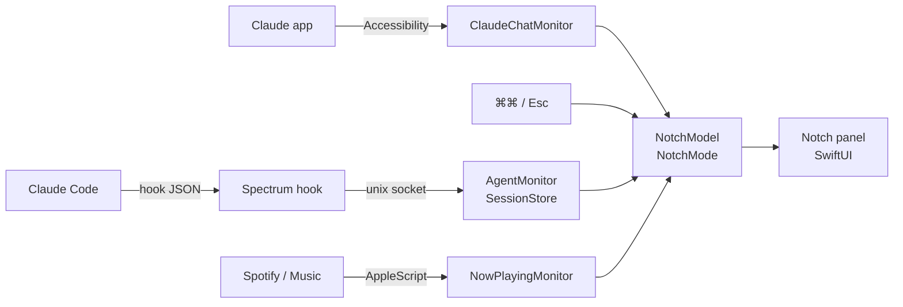

<div align="center">

# Spectrum

**Dynamic Island for the Mac notch: now-playing music and a live pixel office of your AI coding agents.**

[](https://github.com/asykixd/spectrum/actions/workflows/ci.yml)
[](LICENSE)
[](#installation)
[](Package.swift)

</div>

<!-- Demo: add a screenshot or GIF of the notch here once the UI lands, e.g. docs/demo.gif -->

Spectrum is a native macOS notch app written in Swift and SwiftUI that behaves like the iPhone
Dynamic Island. When nothing is playing it is invisible. When music plays, the notch grows into a
compact live activity with artwork and a waveform. Double-tap <kbd>⌘</kbd> and it opens your AI
agents: a list of Claude Code sessions showing who is working and who is waiting for you, and a
pixel-art office where every session sits at its own desk.

> [!NOTE]
> Spectrum is in early development and is not packaged as a signed `.app` yet; it runs from a
> Swift build. See [ROADMAP.md](ROADMAP.md).

## Features

| Feature | Status |
| --- | --- |
| Invisible when idle, like Dynamic Island: nothing outside the hardware notch | Done |
| Compact live activity while music plays: artwork and animated waveform tinted by the artwork | Done |
| Hover to expand: title, artist, progress, previous / play-pause / next, source app icon | Done |
| Spotify and Apple Music, with every featured artist on Spotify tracks | Done |
| Force Touch haptics on MacBook trackpads when the island opens and closes | Done |
| Two-finger swipe across the player: left for next track, right for previous | Done |
| Double-tap <kbd>⌘</kbd> to open the agents panel; moving the pointer out, <kbd>Esc</kbd> or a click outside closes it | Done |
| Sessions tab grouped into Claude Code, Chats and AFK; remove a session with ✕ | Done |
| Click a Claude Code session to read its recent conversation and tool calls | Done |
| Reply to an idle Claude Code session from the panel (background `claude -p --resume`), can be turned off | Done |
| Office tab: desks for working agents, a meeting room for chats, a sofa for AFK agents | Done |
| Office follows the Mac's clock: day sky, sunset, and a dimmed room lit by monitors and desk lamps at night | Done |
| Office agents are Clawd mascots with their own accessories (or people); hover to highlight, click to open | Done |
| Settings: shortcut (⌘⌘ / ⌥⌥ / ⌃⌃), music, chats and their retention, haptics, hooks | Done |
| Claude app chats from the last 15 minutes: you and Claude at a table — thinking, answering, your turn | Done |
| One-click Claude Code hook installer that keeps your existing hooks | Done |
| Signed `.app` bundle | Planned |
| Jump to an agent's terminal, Codex / Cursor / Copilot agents | Planned |
| Browsers and other players | Planned |

## Installation

Requires macOS 14 or later and Swift 6 (Xcode or Command Line Tools). There are no prebuilt
releases yet; build from source:

```sh
git clone https://github.com/asykixd/spectrum.git
cd spectrum
swift build -c release
```

## Usage

Start the app:

```sh
.build/release/Spectrum
```

Connect Claude Code once (or press **Install Claude Code hooks** in the agents panel):

```sh
.build/release/Spectrum install-hooks
```

Then:

- Play something in Spotify or Apple Music: the notch grows a live activity. Hover it for controls;
  swipe left or right with two fingers to change the track. On a MacBook trackpad you feel a light
  tap as the island opens and closes.
- Chat in the Claude desktop app: the chat shows up next to your Claude Code sessions for 15
  minutes after you last had it open.
- Double-tap <kbd>⌘</kbd> to see your agents. Switch between **Sessions** and **Office**. Click a
  Claude Code session to read its conversation; click a chat to jump to the Claude app; hover a
  row and press ✕ to hide it until it does something new.
- In a conversation, type a reply and press Return: Spectrum runs `claude -p --resume <session>`
  in the background, so the answer shows up in Spectrum, not in the session's open terminal.
- In **Office**, hover an agent to highlight it and click it to open its conversation (or the
  Claude app for a chat).
- The gear in the panel opens Settings, installs or removes the hooks and quits Spectrum.
- Nothing playing and the panel closed: Spectrum is invisible.

Spectrum runs as an accessory app with no Dock icon. To quit: `pkill -f Spectrum`.

### Permissions

| Permission | Why |
| --- | --- |
| Accessibility | Watching <kbd>⌘</kbd> and <kbd>Esc</kbd> system-wide; reading chat state from the Claude app |

### Energy

Hidden, Spectrum stays under 1% CPU and about 40 MB of memory: the pointer isn't polled while
the island is hidden, timers allow coalescing, and the players are asked only every few seconds
(their own notifications report changes instantly). Animations run only while visible.

Tracking Claude app chats is the expensive part: Spectrum reads the app's accessibility tree,
and Electron keeps that tree up to date while it is read. Reads drop to every 10 s while Claude
is in the background and pause on battery by default; turn chats off in Settings to avoid the
cost entirely.
| Automation → Spotify / Music | Reading the current track and sending play, pause, next, previous |

While Spectrum runs from a terminal, macOS attributes these permissions to the terminal app.

### Commands

| Command | Description |
| --- | --- |
| `Spectrum` | Run the app |
| `Spectrum install-hooks` | Add Spectrum hooks to `~/.claude/settings.json` (a one-time backup is saved next to it) |
| `Spectrum uninstall-hooks` | Remove only Spectrum's hooks |
| `Spectrum hook` | Called by Claude Code hooks: forwards the event from stdin to the app; silent, always exits 0 |
| `Spectrum preview <dir>` | Render every notch state with sample data to PNG files |

## How it works



- `Sources/SpectrumCore`: UI-free, unit-tested logic: hook events, sessions, socket transport,
  hook installer, now-playing parsing, double-tap detection, notch modes and geometry.
- `Sources/Spectrum`: the AppKit/SwiftUI app: a non-activating `NSPanel` above the menu bar.

MediaRemote, which NotchNook-style apps used to read any player, no longer answers third-party
apps since macOS 15.4, so Spectrum talks to Spotify and Apple Music through their AppleScript
dictionaries. Spotify's dictionary reports only the first artist, so the full list comes from the
track's public embed page.

The Claude desktop app has no hooks. Spectrum reads its accessibility tree: a Stop button means
Claude is answering, the page title names the chat. A chat that just finished answering is
shown as your turn.

## Development

```sh
swift format lint --strict --recursive Sources Tests Package.swift
swift build
swift test
```

<details>
<summary>Running tests with Command Line Tools only (no Xcode)</summary>

The Swift Testing macro plugin is not found by default:

```sh
swift test -Xswiftc -plugin-path -Xswiftc /Library/Developer/CommandLineTools/usr/lib/swift/host/plugins/testing
```

</details>

## Roadmap

See [ROADMAP.md](ROADMAP.md).

## License

[MIT](LICENSE)

---

<div align="center">
<sub>Built with <a href="https://claude.com/claude-code">Claude Code</a>.</sub>
</div>
