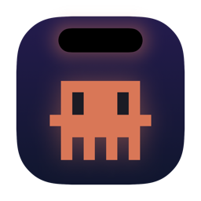
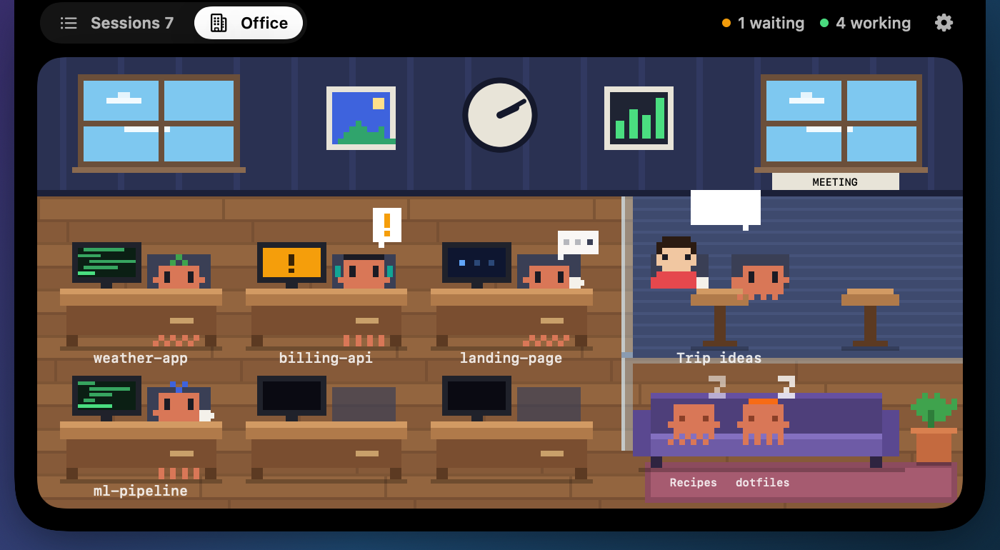
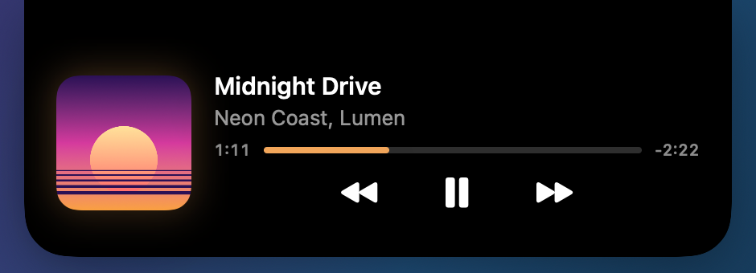
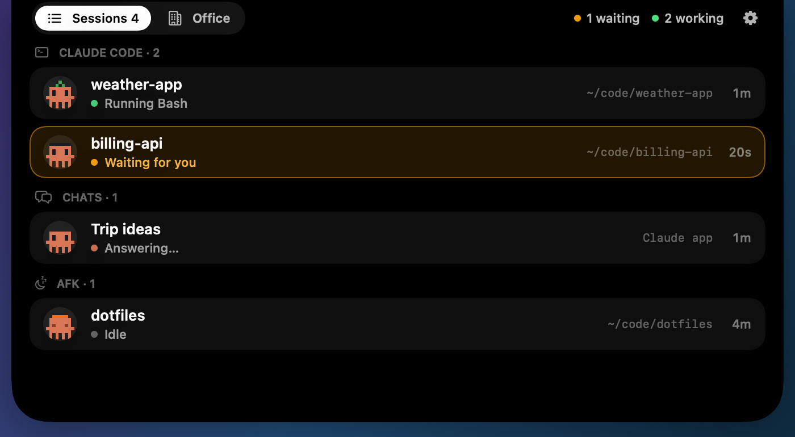
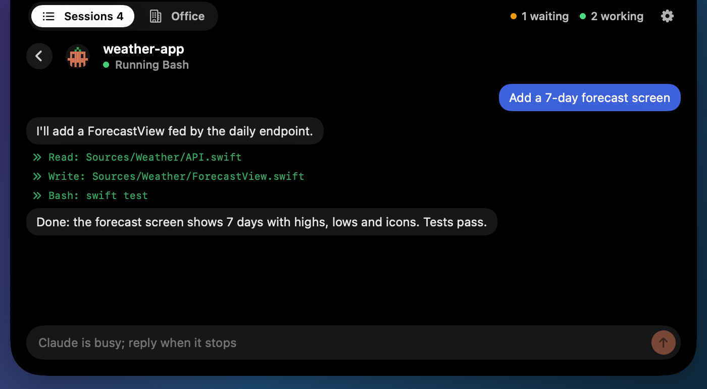
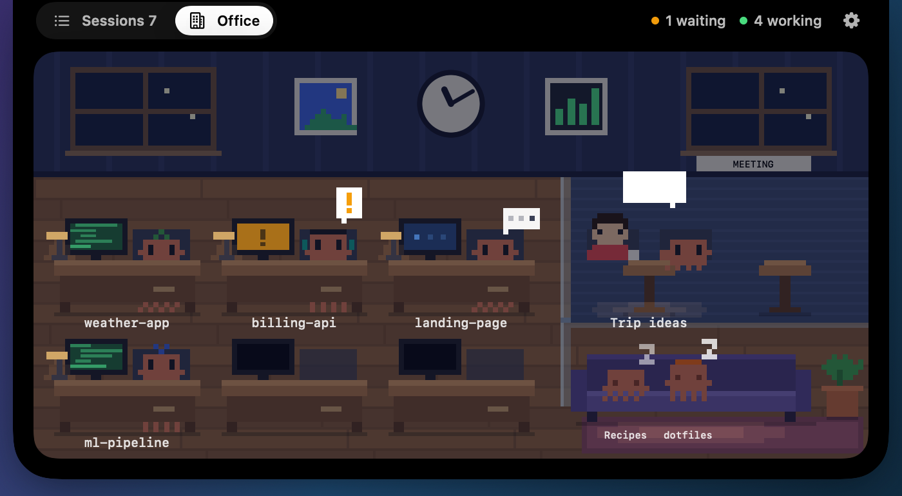
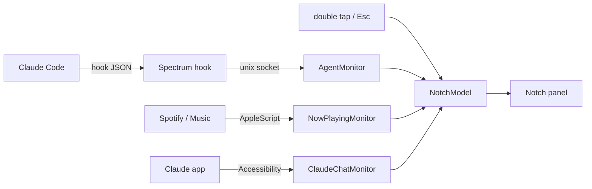

<div align="center">



# Spectrum

**Dynamic Island for the Mac notch: now-playing music and a live pixel office of your Claude agents.**

[](https://github.com/asykixd/spectrum/releases/latest)
[](https://github.com/asykixd/spectrum/actions/workflows/ci.yml)
[](LICENSE)
[](#installation)
[](Package.swift)



</div>

Spectrum is a native macOS app, written in Swift and SwiftUI, that turns the MacBook notch into
an iPhone-style Dynamic Island. When nothing is happening it is invisible. When music plays, the
notch grows a live activity. Double-tap <kbd>⌘</kbd> and it opens your agents: every Claude Code
session and Claude app chat, as a list or as a pixel-art office where Clawd mascots work at their
desks, talk in the meeting room and doze on the sofa.

## Features

### Music


- Invisible when idle; a compact live activity with artwork and a waveform tinted by the cover
  while music plays.
- Hover to expand: title, every featured artist, progress, previous / play-pause / next.
- Two-finger swipe across the player changes the track.
- Spotify and Apple Music.



### Agents

- Double-tap <kbd>⌘</kbd> (or <kbd>⌥</kbd> / <kbd>⌃</kbd>) for the agents panel; move the pointer
  away, press <kbd>Esc</kbd> or click outside to close it.
- **Sessions**: Claude Code agents, Claude app chats and AFK agents in separate groups, with what
  each one is doing right now. Hover a row and press ✕ to hide it until it does something new.
- **Conversation**: click a Claude Code session to read its recent messages and tool calls, and
  reply to it when it is idle.
- **Office**: desks for working agents with screens showing their activity, a meeting room where
  you and Claude talk through a chat, a lounge for idle agents. Hover to highlight, click to open.
  The room follows your Mac's clock, from a blue sky to a lamp-lit night.

| Sessions | Conversation |
| --- | --- |
|  |  |



### Signals

The island calls you only when it matters. When an agent needs permission or an answer it pulses
until you look; when a task finishes it flashes a checkmark for a moment and goes away.


## Installation

1. Download `Spectrum-<version>.zip` from the
   [latest release](https://github.com/asykixd/spectrum/releases/latest) and unzip it.
2. Move `Spectrum.app` to **Applications**.
3. The app is signed ad hoc, not notarized, so macOS blocks the first launch. Clear the
   quarantine flag once:

   ```sh
   xattr -dr com.apple.quarantine /Applications/Spectrum.app
   ```

4. Open Spectrum. It has no Dock icon; double-tap <kbd>⌘</kbd> to see it.
5. In the panel, click the gear → **Install Claude Code Hooks**.

Requires macOS 14 or later, on Apple silicon or Intel.

<details>
<summary>Build from source</summary>

Requires Swift 6 (Xcode or Command Line Tools).

```sh
git clone https://github.com/asykixd/spectrum.git
cd spectrum
scripts/bundle.sh 0.1.0      # dist/Spectrum.app and dist/Spectrum-0.1.0.zip
```

</details>

## Permissions

macOS asks once for each:

| Permission | Why |
| --- | --- |
| Accessibility | The double-tap shortcut and <kbd>Esc</kbd> system-wide; reading chat state from the Claude app |
| Automation → Spotify / Music | Reading the current track and sending play, pause, next, previous |

Spectrum is signed ad hoc, so macOS may ask again after an update.

## Settings

The gear in the agents panel opens Settings, installs or removes the hooks and quits Spectrum.

| Setting | Default |
| --- | --- |
| Show music while it plays | On |
| Pulse when an agent needs permission or an answer | On |
| Flash a checkmark when a task finishes | On |
| Trackpad haptics when the island opens and closes | On |
| Agents panel shortcut | Double-tap ⌘ |
| Office characters | Clawd |
| Reply to idle Claude Code sessions from the panel | On |
| Show chats from the Claude app | On |
| Keep chats listed for | 15 minutes |
| Pause chat tracking on battery | On |
| Drop silent Claude Code sessions after | 1 hour |

## How it works



- **Claude Code** reports to Spectrum through hooks in `~/.claude/settings.json`. Each hook runs
  `Spectrum hook`, which forwards the event over a local socket, stays silent and always exits 0,
  so it never slows an agent down. Your own hooks are kept, and a backup of the file is saved the
  first time.
- **Replies** run `claude -p --resume <session>` in the background: the answer appears in
  Spectrum, not in the session's open terminal.
- **Music**: MediaRemote no longer answers third-party apps since macOS 15.4, so Spectrum asks
  Spotify and Apple Music through AppleScript. Spotify reports only the first artist; the full
  list comes from the track's public embed page.
- **Claude app chats** have no hooks. Spectrum reads the app's accessibility tree: a Stop button
  means Claude is answering, the page title names the chat.

Source layout: `Sources/SpectrumCore` holds the UI-free, unit-tested logic; `Sources/Spectrum` is
the AppKit/SwiftUI app.

## Energy

Hidden, Spectrum stays under 1% CPU and about 40 MB of memory: nothing is polled while the
island is hidden, timers allow coalescing, and animations run only while visible.

Tracking Claude app chats costs the most, in Spectrum and in the Claude app, which keeps its
accessibility tree up to date while it is read. Reads drop to every 10 seconds while Claude is in
the background and pause on battery by default. Turn chats off in Settings to avoid the cost.

## Commands

The app binary doubles as a small CLI:

| Command | Description |
| --- | --- |
| `Spectrum install-hooks` | Add Spectrum's hooks to `~/.claude/settings.json` |
| `Spectrum uninstall-hooks` | Remove only Spectrum's hooks |
| `Spectrum hook` | Called by the hooks; forwards the event on stdin to the app |
| `Spectrum preview <dir>` | Render every state with demo data to PNG files (the screenshots above) |

The binary lives at `/Applications/Spectrum.app/Contents/MacOS/Spectrum`.

## Development

```sh
swift format lint --strict --recursive Sources Tests Package.swift
swift build
swift test
.build/debug/Spectrum            # run without bundling
```

<details>
<summary>Testing with Command Line Tools only (no Xcode)</summary>

The Swift Testing macro plugin is not found by default:

```sh
swift test -Xswiftc -plugin-path -Xswiftc /Library/Developer/CommandLineTools/usr/lib/swift/host/plugins/testing
```

</details>

Releases are built by `.github/workflows/release.yml` when a `v*` tag is pushed. See
[CHANGELOG.md](CHANGELOG.md) and [ROADMAP.md](ROADMAP.md).

## License

[MIT](LICENSE)

---

<div align="center">
<sub>Built with <a href="https://claude.com/claude-code">Claude Code</a>. Clawd is Anthropic's Claude Code mascot; Spectrum is not affiliated with Anthropic.</sub>
</div>
